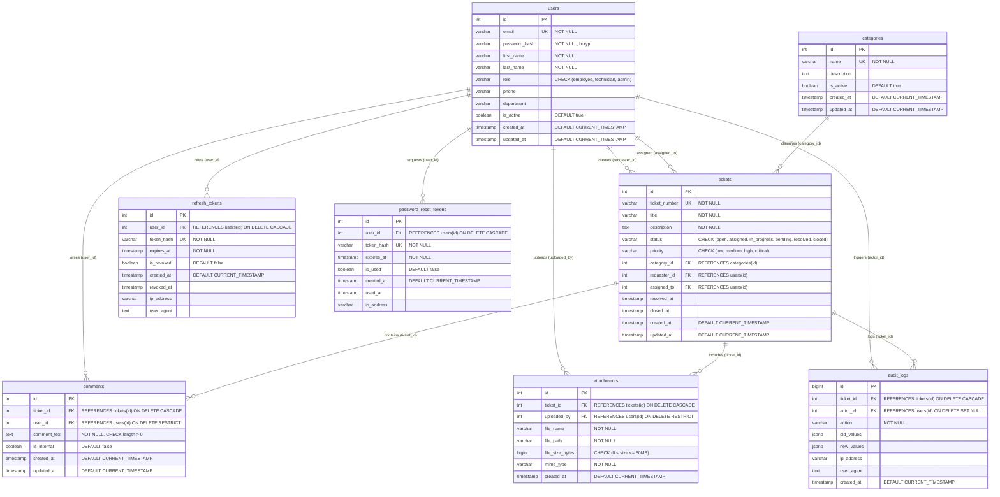

# PostgreSQL Database Design Specification - Phase 2

## 1. Overview
The **Smart IT Helpdesk Management System** persistence tier is architected for PostgreSQL 12+. It enforces referential integrity, strict domain type checking, auditable events, and performance optimization through compound and GIN indexing.

All SQL scripts are stored under:
- `backend/database/migrations/00_init_database_and_user.sql`: Database & least-privilege user creation.
- `backend/database/migrations/01_schema_ddl.sql`: Relational tables, constraints, foreign keys, and indexes.
- `backend/database/seeds/02_sample_data.sql`: Seed data for development and testing.
- `backend/database/queries/03_demonstration_queries.sql`: SQL demonstrations (SELECT, INSERT, UPDATE, DELETE, GROUP BY, HAVING, JOINS, COUNT, AVG).

---

## 2. Entity-Relationship (ER) Diagram



---

## 3. Relational Tables and Constraints

### 3.1 `users`
- **Primary Key**: `id` (`SERIAL`)
- **Unique**: `email`
- **Constraints**:
  - `chk_users_role`: `role IN ('employee', 'technician', 'admin')`
  - `chk_users_email`: Regex check for valid RFC compliant email structure.
- **Security**: `password_hash` stores bcrypt/argon2 hashes; plaintext is forbidden.

### 3.2 `categories`
- **Primary Key**: `id` (`SERIAL`)
- **Unique**: `name`
- **Constraints**: `is_active` defaults to `TRUE`.

### 3.3 `tickets`
- **Primary Key**: `id` (`SERIAL`)
- **Unique**: `ticket_number`
- **Foreign Keys**:
  - `category_id` -> `categories(id)` (`ON DELETE RESTRICT`, `ON UPDATE CASCADE`)
  - `requester_id` -> `users(id)` (`ON DELETE RESTRICT`, `ON UPDATE CASCADE`)
  - `assigned_to` -> `users(id)` (`ON DELETE SET NULL`, `ON UPDATE CASCADE`)
- **Constraints**:
  - `chk_tickets_status`: `status IN ('open', 'assigned', 'in_progress', 'pending', 'resolved', 'closed')`
  - `chk_tickets_priority`: `priority IN ('low', 'medium', 'high', 'critical')`
  - `chk_tickets_resolution_order`: `resolved_at IS NULL OR resolved_at >= created_at`
  - `chk_tickets_closed_order`: `closed_at IS NULL OR closed_at >= created_at`

### 3.4 `comments`
- **Primary Key**: `id` (`SERIAL`)
- **Foreign Keys**:
  - `ticket_id` -> `tickets(id)` (`ON DELETE CASCADE`)
  - `user_id` -> `users(id)` (`ON DELETE RESTRICT`)
- **Constraints**:
  - `chk_comments_non_empty`: `LENGTH(TRIM(comment_text)) > 0`
  - `is_internal`: Distinguishes private staff notes from user-facing replies.

### 3.5 `attachments`
- **Primary Key**: `id` (`SERIAL`)
- **Foreign Keys**:
  - `ticket_id` -> `tickets(id)` (`ON DELETE CASCADE`)
  - `uploaded_by` -> `users(id)` (`ON DELETE RESTRICT`)
- **Constraints**:
  - `chk_attachments_file_size`: Must be between 1 byte and 52,428,800 bytes (50 MB).

### 3.6 `audit_logs`
- **Primary Key**: `id` (`BIGSERIAL`)
- **Foreign Keys**:
  - `ticket_id` -> `tickets(id)` (`ON DELETE CASCADE`)
  - `actor_id` -> `users(id)` (`ON DELETE SET NULL`)
- **Special Columns**:
  - `old_values` (`JSONB`): State before change.
  - `new_values` (`JSONB`): State after change.

### 3.7 `refresh_tokens`
- **Primary Key**: `id` (`SERIAL`)
- **Unique**: `token_hash`
- **Foreign Keys**: `user_id` -> `users(id)` (`ON DELETE CASCADE`)

### 3.8 `password_reset_tokens`
- **Primary Key**: `id` (`SERIAL`)
- **Unique**: `token_hash`
- **Foreign Keys**: `user_id` -> `users(id)` (`ON DELETE CASCADE`)

---

## 4. Indexing Strategy

| Index Name | Table | Columns / Expression | Index Type | Purpose |
| :--- | :--- | :--- | :--- | :--- |
| `idx_users_email` | `users` | `email` | B-tree | Fast O(log N) lookup during login |
| `idx_users_role` | `users` | `role` | B-tree | Fast technician/admin filtering |
| `idx_tickets_number` | `tickets` | `ticket_number` | B-tree | Exact lookup by human-readable ID |
| `idx_tickets_status` | `tickets` | `status` | B-tree | Queue filtering (open, assigned) |
| `idx_tickets_priority` | `tickets` | `priority` | B-tree | SLA sorting and escalation queues |
| `idx_tickets_requester`| `tickets` | `requester_id` | B-tree | "My Tickets" user dashboard |
| `idx_tickets_assigned` | `tickets` | `assigned_to` | B-tree | "Assigned to Me" technician queue |
| `idx_tickets_queue` | `tickets` | `(status, priority, assigned_to)` | Composite B-tree | Complex multi-filter helpdesk triage |
| `idx_comments_ticket` | `comments` | `(ticket_id, created_at ASC)` | Composite B-tree | Chronological comment thread rendering |
| `idx_audit_new_gin` | `audit_logs` | `new_values` | GIN | JSONB attribute searching in audit trail |

---

## 5. Security & Least-Privilege Role Configuration

Application traffic connects through a non-superuser role `helpdesk_app`:
```sql
CREATE ROLE helpdesk_app WITH LOGIN PASSWORD 'helpdesk_secure_pass_phase2' NOSUPERUSER NOCREATEDB NOCREATEROLE;
GRANT CONNECT ON DATABASE smart_helpdesk TO helpdesk_app;
GRANT USAGE ON SCHEMA public TO helpdesk_app;
GRANT SELECT, INSERT, UPDATE, DELETE ON ALL TABLES IN SCHEMA public TO helpdesk_app;
GRANT USAGE, SELECT ON ALL SEQUENCES IN SCHEMA public TO helpdesk_app;
```
This guarantees that even if application credentials were compromised, the account cannot drop databases, modify server configuration, or access other databases on the PostgreSQL cluster.
